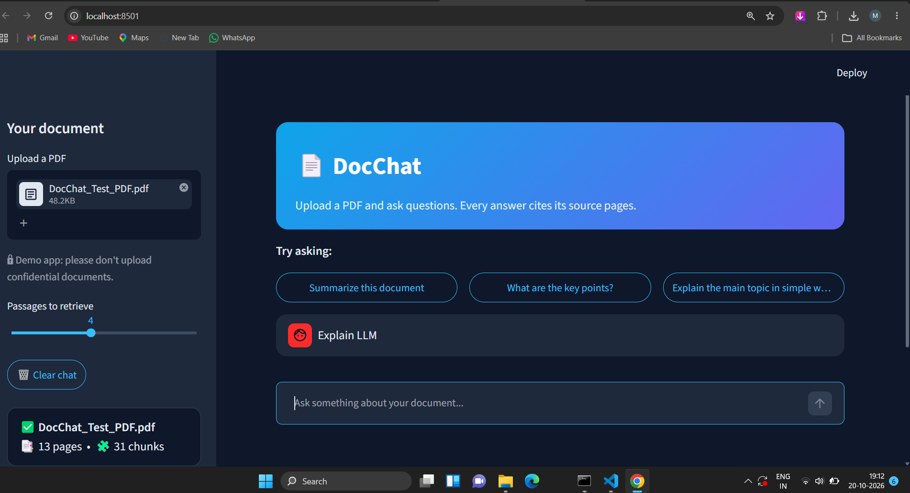

# 📄 DocChat: Chat with your PDF

A retrieval-augmented generation (RAG) app. Upload a PDF, ask questions in plain
language, and get streamed answers with page-level citations.

## 📸 Project Screenshots

### Screenshot 1: Dashboard

### Screenshot 2: Project Output

## Features
- PDF text extraction, overlapping chunking, and semantic search using embeddings
- Answers grounded in the document, with cited pages and a sources panel
- Follow-up questions handled by automatic query rewriting
- Refuses to answer when the document has no answer, to reduce hallucination
- Streaming responses, dark UI, and friendly handling of API rate-limit errors

## How it works
**Indexing (once per PDF):**
PDF → text per page → chunks (800 characters, 150 overlap) →
embeddings (all-MiniLM-L6-v2) → stored in ChromaDB with page numbers.

**Answering (each question):**
Question → rewritten as a standalone question if it's a follow-up → embedded →
top-k similar chunks retrieved → chunks + question sent to the LLM → answer with citations.

## Tech stack
Python · Streamlit · ChromaDB · Sentence-Transformers · Groq API · pypdf

## Evaluation
Tested on an 11-question set: 9 questions answerable from the document and 2
out-of-document questions that the app should refuse to answer.

| Chunk size | k=2 | k=4 | k=6 |
|---|---|---|---|
| 400 | 100% | 100% | 100% |
| 800 (baseline) | 100% | 100% | 100% |
| 1200 | 100% | 100% | 100% |

Retrieval hit rate = the page containing the answer was among the retrieved chunks.
Final answer accuracy: 100% (11/11) at chunk size 800, k=4.

Note: every configuration scored 100%, so this small set cannot separate the
settings. A larger, harder question set is planned.

## Limitations and next steps
- Works only with text PDFs; scanned PDFs would need OCR
- Uses an in-memory vector store, so the index resets when the app restarts
- Planned improvements: hybrid keyword + vector search, re-ranking, persistent storage